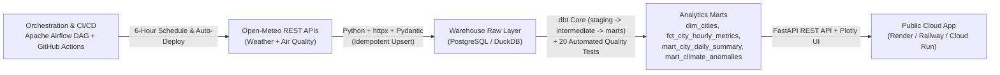

# SkyPulse — Cloud-Native Weather & Air Quality Data Engineering Platform (Zero AWS)

[](https://github.com/FabricioRams/Actividad-Grupal-01-U2-Data-Enginnering/actions/workflows/ci-cd.yml)

**SkyPulse** is an end-to-end, automated Data Engineering platform that ingests live hourly weather and air-quality telemetry from the **Open-Meteo API** for 10 global cities, transforms and validates the data through a **dbt Core Medallion Architecture**, orchestrates workflows with **Apache Airflow** and **GitHub Actions**, and serves real-time analytics through a **FastAPI + Plotly** dashboard deployed to a public PaaS (**Render**) backed by managed **PostgreSQL** — **without using any AWS services**.

---

## Architecture



### Tech Stack (100% AWS-Free)

| Layer | Technology | Purpose |
| :--- | :--- | :--- |
| **Data Sources** | Open-Meteo Forecast & Air Quality APIs | Free, keyless hourly meteorological & pollutant telemetry |
| **Ingestion** | Python 3.12, `httpx`, `tenacity`, `pydantic` | Resilient extraction with retries, schema validation & idempotent upserts |
| **Storage / Warehouse** | **PostgreSQL** (Production: Render / Neon) & **DuckDB** (Local/CI) | Dual-backend warehouse supporting zero-config local runs and cloud SQL |
| **Transformation & DQ** | **dbt Core** (`dbt-postgres`, `dbt-duckdb`) | Medallion models (`staging` -> `intermediate` -> `marts`) + 20 schema/singular tests |
| **Orchestration** | **Apache Airflow** (`airflow/dags/skypulse_elt_dag.py`) + **GitHub Actions** | Containerized Airflow DAG + serverless 6-hour scheduled ELT in CI/CD |
| **Serving & UI** | **FastAPI**, Uvicorn, Plotly.js, Tailwind CSS | OpenAPI endpoints (`/api/v1/*`, `/docs`, `/health`) + live interactive dashboard (`/`) |
| **Cloud / SaaS Hosting** | **Render** (`render.yaml` Blueprint) + **GitHub Actions** | Automated Docker build, test, and push-to-deploy PaaS hosting |

---

## Quickstart (Local with DuckDB)

```bash
python -m venv .venv
# Windows PowerShell: .\.venv\Scripts\Activate.ps1
# Linux/macOS: source .venv/bin/activate
pip install -r requirements-dev.txt

# 1. Run live Open-Meteo ELT pipeline + dbt build (run + test)
python -m src.ingestion.run_pipeline

# 2. Launch FastAPI & Interactive Dashboard
uvicorn src.api.main:app --reload
```

Open `http://127.0.0.1:8000` for the dashboard and `http://127.0.0.1:8000/docs` for Swagger/OpenAPI.

## Full Stack with Apache Airflow + PostgreSQL (Docker Compose)

```bash
docker compose up --build
```

- **Apache Airflow UI**: `http://localhost:8080` (runs `skypulse_weather_air_quality_elt` DAG)
- **SkyPulse Analytics App**: `http://localhost:8000`
- **PostgreSQL Warehouse**: `localhost:5432` (`skypulse`)

## Running Tests & Linting

```bash
ruff check src tests scripts
pytest -v
```

## Automated Public Cloud Deployment (Render + GitHub Actions)

1. Connect this repository in **Render** as a **Blueprint** (uses `render.yaml` to provision a managed PostgreSQL database and Docker Web Service automatically with zero AWS).
2. Add optional GitHub repository secrets for scheduled 6-hour cloud ELT refreshes and deploy hooks:
   - `DATABASE_URL`: External PostgreSQL connection string (from Render PostgreSQL or Neon Azure/GCP).
   - `RENDER_DEPLOY_HOOK_URL`: Render Deploy Hook URL to trigger automated deploys on push to `main`.

## Publishing the Dev.to Article

The full technical article is available at [`docs/devto_article.md`](docs/devto_article.md). To publish via the Dev.to API:

```bash
export DEVTO_API_KEY="your_devto_api_key"
python scripts/publish_devto.py docs/devto_article.md
```
